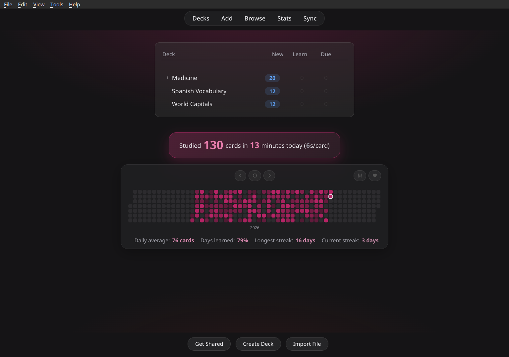
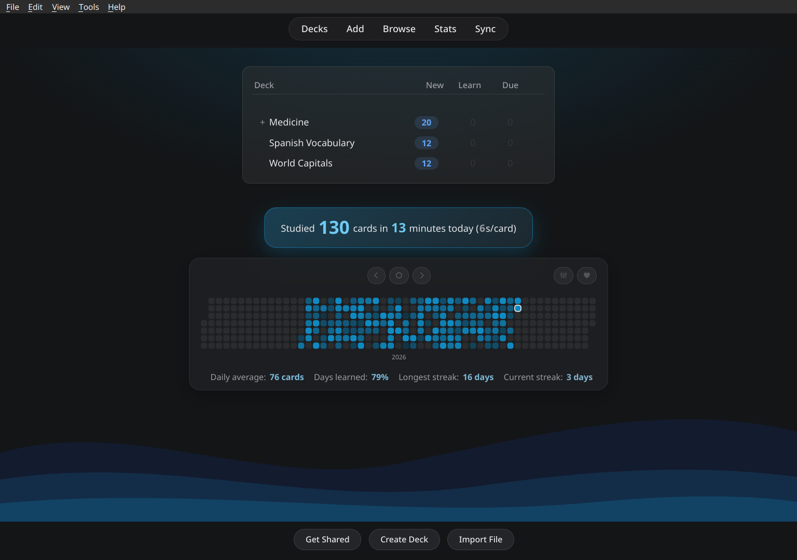
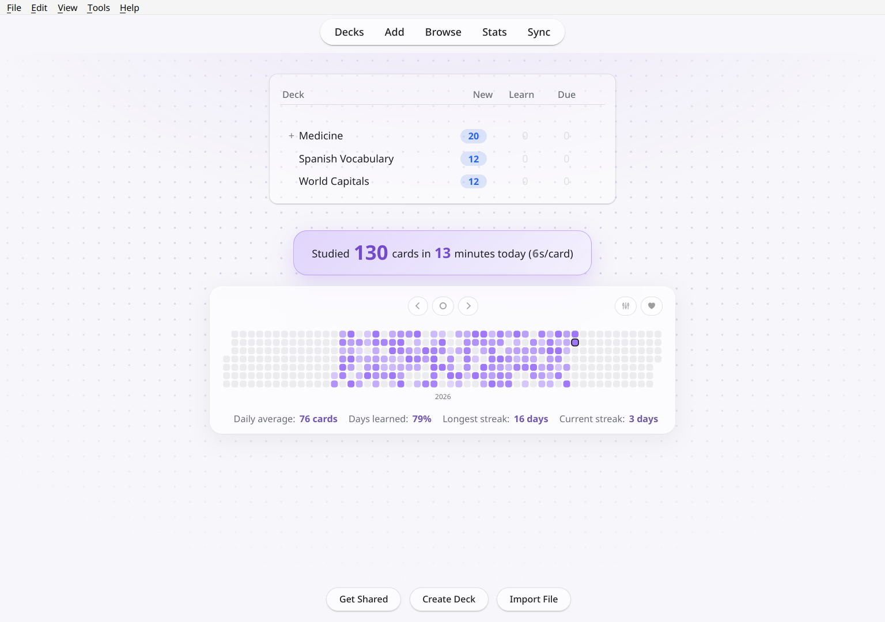
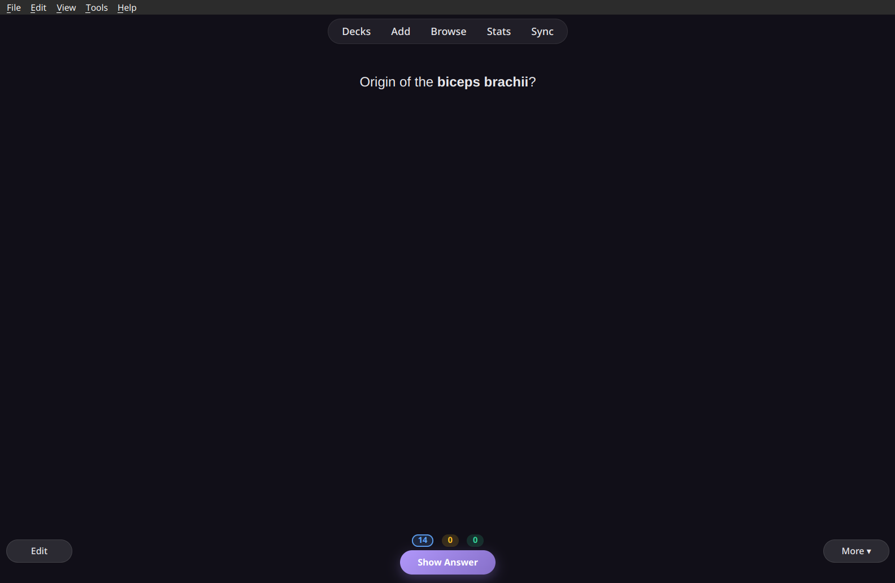
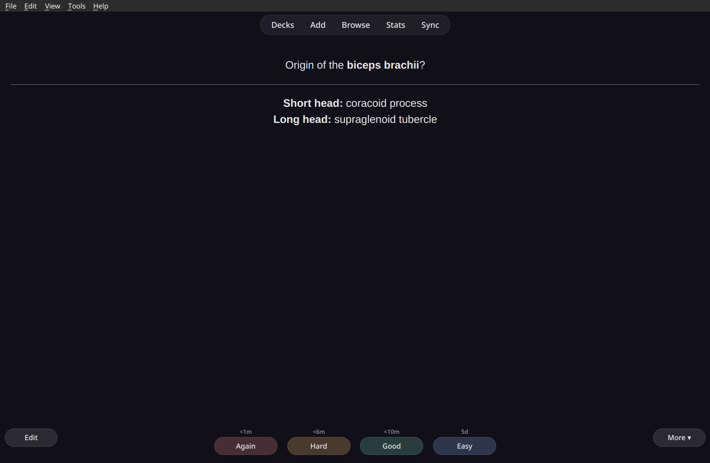
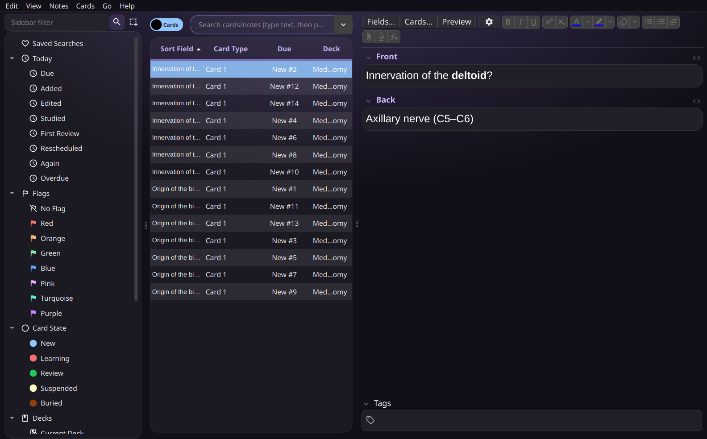
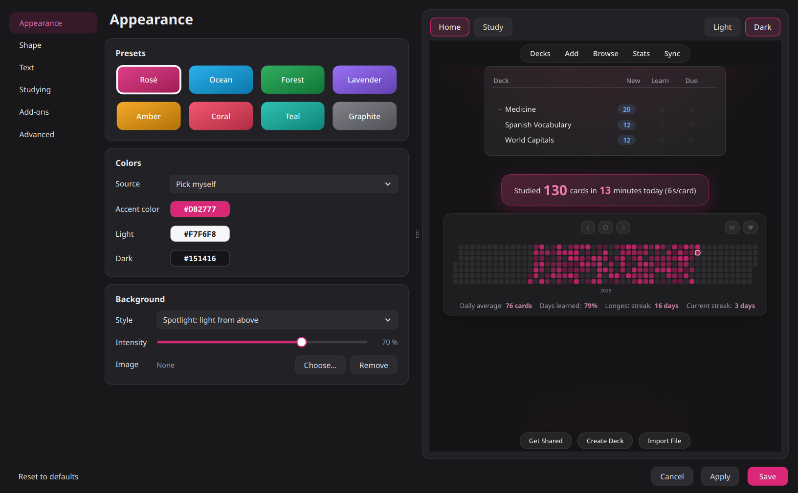

# Deckorator

**Decorate your Anki decks.** A modern, customizable theme for Anki's deck list, overview and study screen. It stays quiet while you study.

**Install:** in Anki go to *Tools → Add-ons → Get Add-ons…* and enter **`1326296861`**
([AnkiWeb page](https://ankiweb.net/shared/info/1326296861))

## Features

- **23 theme packs** for a complete look in one click: illustrated (Fuji, lofi city, sakura, mountains, planet, flow lines, topography, Bauhaus) and photo wallpapers
- **Illustrated wallpapers** drawn for Deckorator: they take on your accent color and have light and dark versions
- **Banner in the top bar** behind Decks, Add, Browse …
- **My designs**: save your look, or turn any wallpaper into a complete theme (accent and tones adapt), share as a .deckorator file
- **Add-on center**: your add-ons as cards with a switch, settings and page link
- **Plays well with other add-ons**: their content below the deck list gets a matching card; other theme add-ons are detected
- **Every area adjustable**: bold, subtle or Anki's original look, per window
- **8 color presets** or your own accent color. The accent can also come from your **system accent color** or your **desktop wallpaper**.
- **Backgrounds:** spotlight, dot grid, line grid, grain, waves, your own image, or your **desktop wallpaper**. The wallpaper is re-synced on every start, and live/video wallpapers become a still image.
- **Calm study mode:** while you review, the background stays quiet so the card comes first.
- **Readable review counters** (new / learning / review) and tinted answer buttons
- **"Studied today" highlighted** on the home screen
- **[Review Heatmap](https://ankiweb.net/shared/info/1771074083) support:** fully restyled, colors only, or left untouched
- **Performance mode:** on weak laptops (4 CPU threads or less, software rendering, on battery) blur is switched off automatically
- **Card browser, editor, statistics, deck options, preferences and add-ons window** in the same style (flag, marked and suspended colors stay as in Anki), each can be switched off
- **Settings window with a live preview of your own decks and cards**, light and dark mode, theme export and import
- English and German interface, follows Anki's language

| Waves, dark | Dot grid, light |
|---|---|
|  |  |

| Studying: question | Studying: answer |
|---|---|
|  |  |

## Settings

*Tools → Deckorator – Theme settings…* or the **Config** button in the add-on manager.

Deckorator only changes how Anki looks. Your cards and note types are never modified. During reviews, card backgrounds come from your note type unless you choose otherwise.

## Reporting a problem

Open the settings, go to **Advanced → Help & feedback → Copy diagnostic report** and paste the report into a [new issue](../../issues/new). It contains your Anki/Qt version, OS, the detected hardware, your Deckorator settings and recent errors. It does not include card contents or file paths. Nothing is ever sent automatically.

## Compatibility

Tested with Anki 26.09 on Linux (KDE Plasma, Wayland). It should work from Anki 25.02 on. Wallpaper and accent detection supports KDE, GNOME, Windows and macOS. Reports from Windows and macOS are very welcome.

## Development

The add-on lives in [`addon/`](addon). Symlink it into Anki's add-on folder (`addons21/deckorator`) while working on it. `./build.sh` creates `dist/deckorator.ankiaddon` for upload to AnkiWeb.

## License

[GNU AGPL v3](LICENSE), the same license as Anki itself. The bundled wallpapers are CC0 or public domain, see [addon/wallpapers/CREDITS.md](addon/wallpapers/CREDITS.md).
