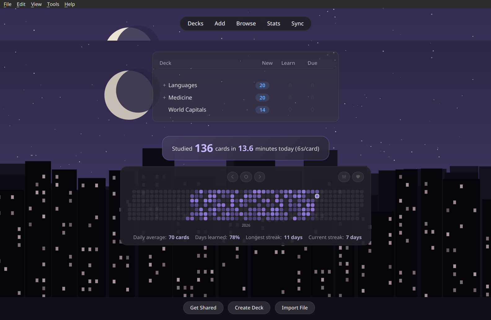
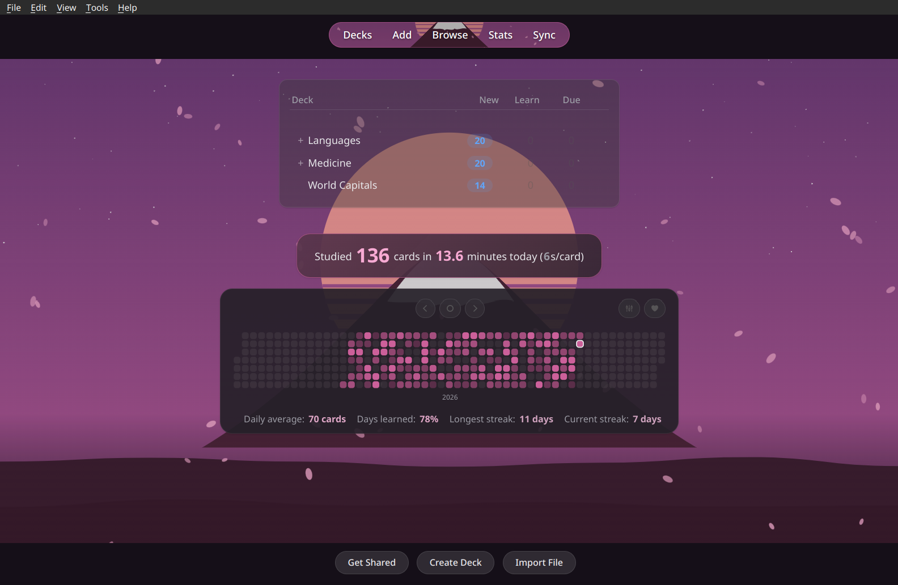
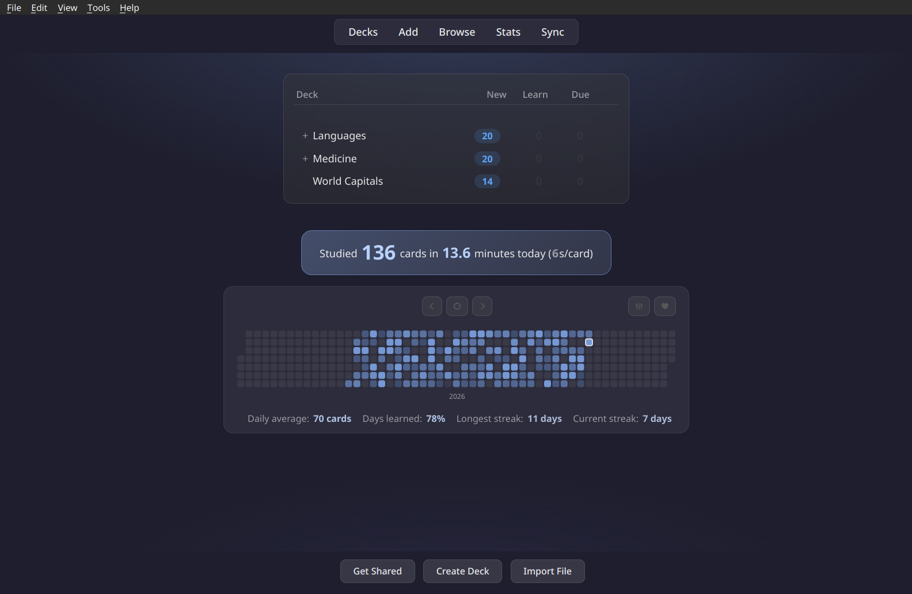
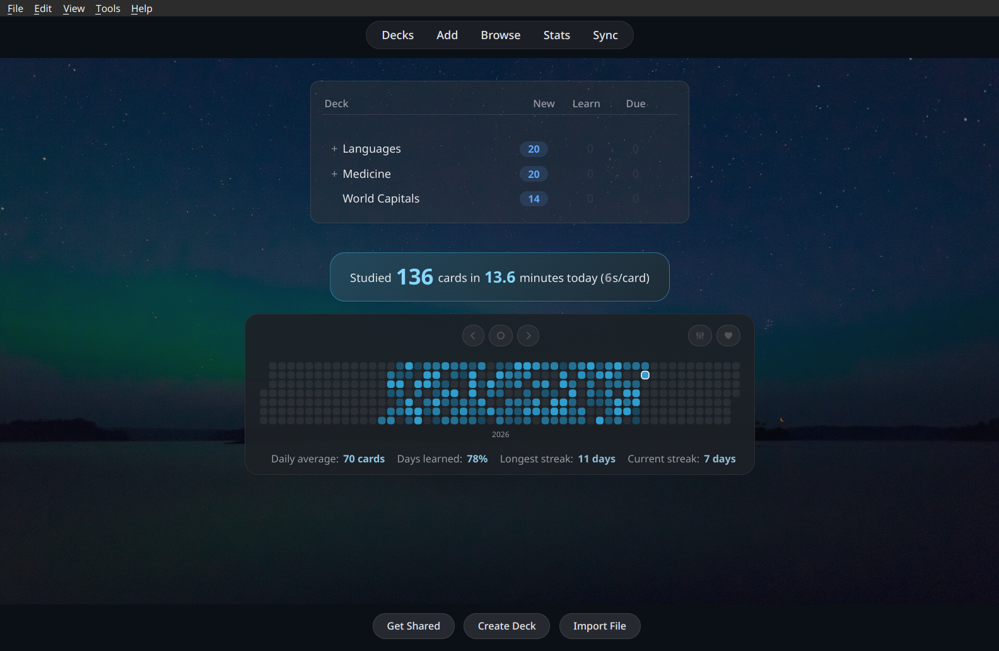
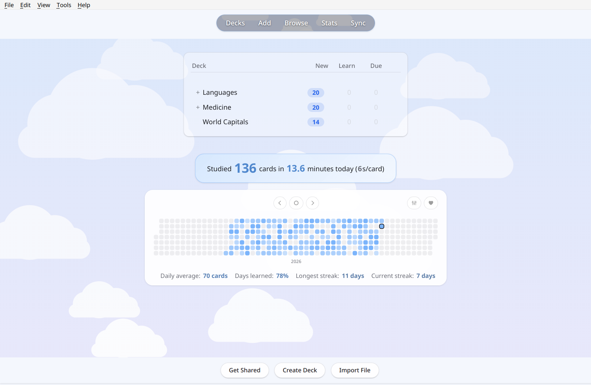
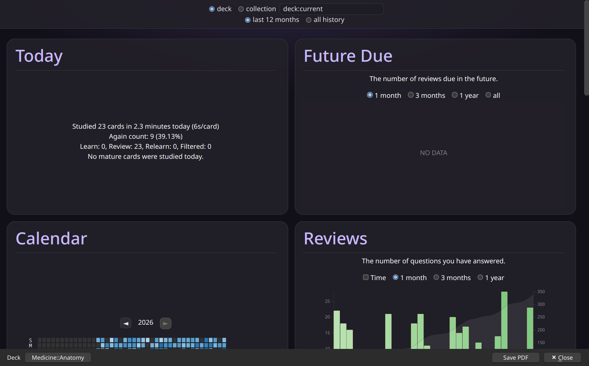
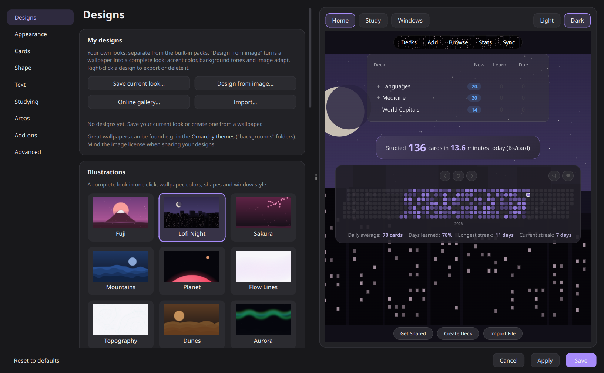
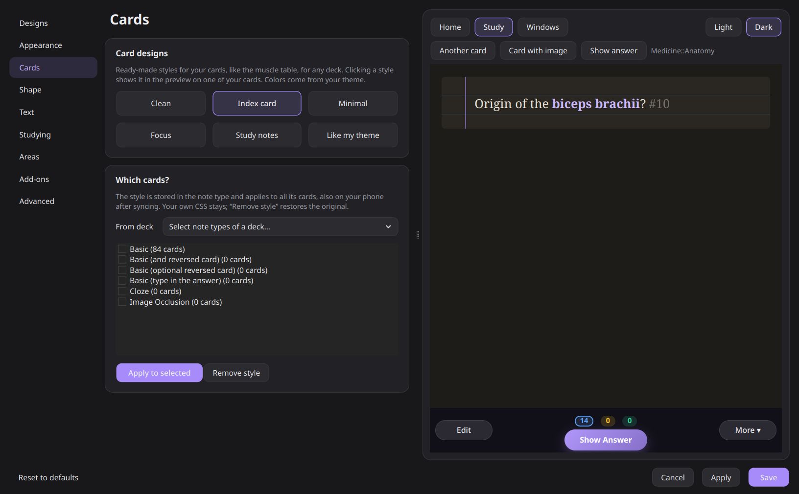
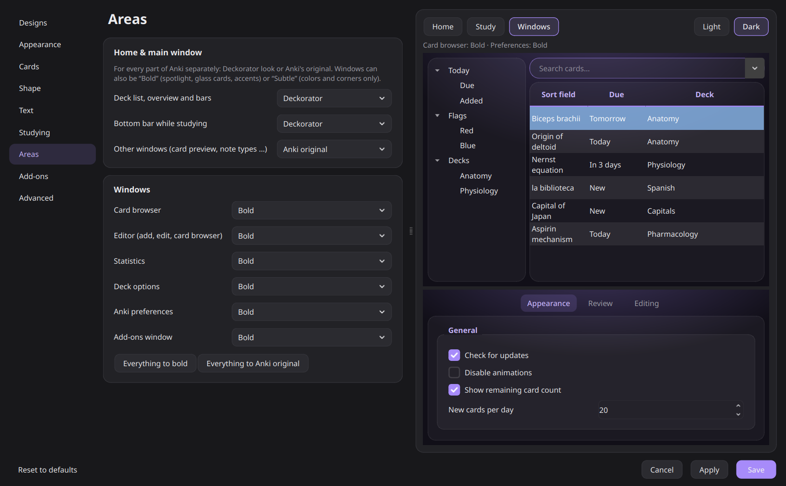

# Deckorator

**Decorate your Anki decks.** A modern, customizable theme for Anki's deck list, overview, study screen and windows. It stays quiet while you study.

**Install:** in Anki go to *Tools → Add-ons → Get Add-ons…* and enter **`1326296861`**
([AnkiWeb page](https://ankiweb.net/shared/info/1326296861))

## Features

**Looks**
- **46 theme packs** for a complete look in one click: illustrations, photos, the Omarchy color themes (Catppuccin, Gruvbox, Nord, Tokyo Night …) and minimal patterns
- **Illustrated wallpapers** drawn for Deckorator that take on your accent color, with light and dark versions
- **My designs**: save your look or turn any wallpaper into a complete theme (accent and tones adapt), share as `.deckorator` files
- **Online gallery**: browse wallpapers from Omarchy and ML4W on GitHub and use them as designs
- **21 color presets**, a quick color pick, or take the accent from your **system** or **desktop wallpaper**
- **Backgrounds**: spotlight, dot grid, line grid, grain, waves, illustration, your own image (also a separate one for dark mode) or your **desktop wallpaper**
- **Banner** behind the top bar, or only inside the tab capsule

**Studying**
- **Calm study mode**: the background stays quiet so the card comes first
- **Card designs**: six styles for any note type, previewed on your own cards and fully reversible
- Readable review counters, answer buttons tinted by rating, "studied today" highlighted

**Windows & add-ons**
- **Card browser, editor, statistics, deck options, preferences and add-ons window** in the same style, bold or subtle
- **Every area adjustable**: Deckorator look or Anki's original, per window
- **Add-on center**: your add-ons as cards with a switch, settings and page link
- Content other add-ons place below the deck list gets a matching card; other theme add-ons are detected
- **[Review Heatmap](https://ankiweb.net/shared/info/1771074083) support**: fully restyled, colors only, or left untouched

**Comfort**
- **Performance mode**: blur is switched off automatically on weak laptops; glow effects can be turned off
- **Settings window with a live preview** of your own decks, cards and windows, light and dark
- English and German interface, follows Anki's language

## Screenshots

| Fuji with banner in the tab bar | Catppuccin (Omarchy color theme) |
|---|---|
|  |  |

| Winter, dark mode (aurora photo) | Clouds, light mode |
|---|---|
|  |  |

| Calm study screen | Answer buttons tinted by rating |
|---|---|
|  |  |

| Card browser | Statistics |
|---|---|
|  |  |

**Settings**: designs, card designs and areas, all with a live preview

| Card designs | Areas & window preview |
|---|---|
|  |  |

## Settings

*Tools → Deckorator – Theme settings…* or the **Config** button in the add-on manager.

Deckorator only changes how Anki looks. It never touches your cards. The one exception you control yourself: **card designs** add a clearly marked CSS block to the note types you choose, and "Remove style" restores the original.

## Reporting a problem

Open the settings, go to **Advanced → Help & feedback → Copy diagnostic report** and paste the report into a [new issue](../../issues/new). It contains your Anki/Qt version, OS, the detected hardware, your Deckorator settings and recent errors. It does not include card contents or file paths. Nothing is ever sent automatically.

## Compatibility

Tested with Anki 26.09 on Linux (KDE Plasma, Wayland). It should work from Anki 25.02 on. Wallpaper and accent detection supports KDE, GNOME, Windows and macOS. Reports from Windows and macOS are very welcome.

## Development

The add-on lives in [`addon/`](addon). Symlink it into Anki's add-on folder (`addons21/deckorator`) while working on it. `./build.sh` creates `dist/deckorator.ankiaddon` for upload to AnkiWeb.

## License

[GNU AGPL v3](LICENSE), the same license as Anki itself. The bundled wallpapers are CC0 or public domain, see [addon/wallpapers/CREDITS.md](addon/wallpapers/CREDITS.md).

## Releasing

1. Bump `VERSION` in `addon/__init__.py` and add an entry to `CHANGELOG.md`
2. Run `./build.sh`
3. Upload `dist/deckorator.ankiaddon` on AnkiWeb (add-on `1326296861`)
